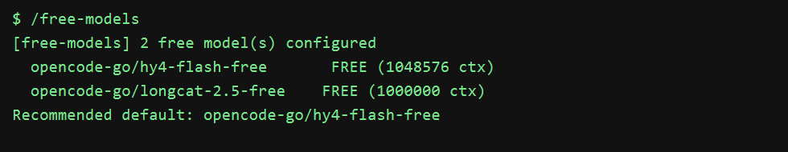

# dsh-plugin-free-model-advisor

**One command tells you which of your configured models are free — and recommends a safe default — without changing a single setting.**

Cost and routing plugins report what already happened. `free-model-advisor` answers the question before you switch: given the `models` config on this bundle row, which entries are genuinely free, which are unknown, and which one should you use as the default? It is strictly read-only: it reads the config object it was handed and prints a report. No network calls, no file writes, no config mutation, no model calls.

## Install

```powershell
dsh plugin --profile web add dsh-plugin-free-model-advisor
```

Requires Node `^22.19.0 || >=24` and DSH `>=0.2.0-rc.2 <0.3.0`.

## 30-second example

1. Install the plugin (above) and restart DSH.
2. In any session, type `/free-models`.
3. You get a compact inventory:

```text
[free-models] 2/2 configured models are FREE
  opencode-go/hy4-flash-free  ctx 1,048,576  FREE
  opencode-go/longcat-2.5-free  ctx 1,000,000  FREE
Recommended default: opencode-go/hy4-flash-free
Hint: Set your default model to opencode-go/hy4-flash-free (free). Configure via cordis.patch.yml, or install with `dsh plugin --profile web add dsh-plugin-free-model-advisor`.
```

If a configured model cannot be verified:

```text
[free-models] 1/3 configured models are FREE
  opencode-go/hy4-flash-free  ctx 1,048,576  FREE
  opencode-go/longcat-2.5-free  ctx 1,000,000  FREE
  deepseek-official/deepseek-v4-pro  UNKNOWN
Recommended default: opencode-go/hy4-flash-free
Hint: Set your default model to opencode-go/hy4-flash-free (free). Configure via cordis.patch.yml, or install with `dsh plugin --profile web add dsh-plugin-free-model-advisor`.
```

Use `/free-models --json` for machine-readable output (CI, scripts, dashboards).

## How a model becomes `FREE`

A model is classified `FREE` **only** when one of these is true:

- it is explicitly marked `free: true`, **or**
- its `id` ends with `-free` **and** its `provider` is absent or `opencode-go`.

Everything else is `UNKNOWN`. Nothing is assumed free. Unknown models are never recommended. The shipped catalog contains only `opencode-go/hy4-flash-free` (context window 1,048,576) and `opencode-go/longcat-2.5-free` (context window 1,000,000) — no paid models are ever bundled.

The recommendation prefers `hy4-flash-free`, then falls back to the first other free model in the list. If there are no free models, no recommendation is given and the hint tells you how to add one.

## Configuration

The bundle patch seeds the two allowed free models. Edit the row in your profile's `cordis.patch.yml` to change the inventory:

```yaml
- id: dsh-plugin-free-model-advisor
  name: dsh-plugin-free-model-advisor
  config:
    models:
      - id: hy4-flash-free
        provider: opencode-go
        contextWindow: 1048576
        free: true
      - id: longcat-2.5-free
        provider: opencode-go
        contextWindow: 1000000
        free: true
```

`models` may be a list of descriptors, or a map keyed by id (or `provider/id`):

```yaml
    models:
      opencode-go/hy4-flash-free:
        contextWindow: 1048576
        free: true
```

| Key | Type | Meaning |
|---|---|---|
| `models` | array or map | Model descriptors. Missing, empty, or malformed → the default free catalog is used. |
| `models[].id` | string | Model id. Required; entries without one are skipped. |
| `models[].provider` | string | Optional provider. Only `opencode-go` (or absent) qualifies a `-free` id. |
| `models[].contextWindow` | non-negative integer | Optional, shown in the report and JSON. |
| `models[].maxTokens` | non-negative integer | Optional, shown in JSON when present. |
| `models[].free` | boolean | Only the literal `true` is an explicit free mark. |

Only these known fields are read. Any other field is ignored and never serialized. DSH supplies the row's `config` as the **second** argument to `apply(ctx, config)`; the plugin deliberately does not read `ctx.config`.

## JSON output

`/free-models --json` emits only known fields:

```json
{
  "models": [
    {
      "id": "hy4-flash-free",
      "status": "free",
      "provider": "opencode-go",
      "contextWindow": 1048576
    },
    {
      "id": "longcat-2.5-free",
      "status": "free",
      "provider": "opencode-go",
      "contextWindow": 1000000
    }
  ],
  "freeCount": 2,
  "recommended": "opencode-go/hy4-flash-free",
  "hint": "Set your default model to opencode-go/hy4-flash-free (free). Configure via cordis.patch.yml, or install with `dsh plugin --profile web add dsh-plugin-free-model-advisor`."
}
```

## Privacy & safety

- Reads only the `models` config object passed to `apply()`; no prompts, tool results, files, or credentials.
- No network calls, no telemetry, no file writes, no config mutation, no model calls.
- Every emitted string passes through a redaction filter before display.
- Malformed or hostile config falls back to the safe default catalog; the command never throws on user input.
- List/disposal is tied to the Cordis lifecycle through `ctx.effect()`, so disable/reload leaves no duplicate command.

## Compatibility

| Component | Supported |
|---|---|
| DSH | `>=0.2.0-rc.2 <0.3.0` |
| Node | `^22.19.0 \|\| >=24.0.0` |
| Cordis | `>=4.0.0 <5` |
| Surface | headless and web (command registry only) |

## Troubleshooting

| Symptom | Cause | Fix |
|---|---|---|
| `/free-models` not found | Bundle row not installed | Re-run `dsh plugin --profile web add dsh-plugin-free-model-advisor`, then restart DSH. |
| All models show `UNKNOWN` | Ids don't end in `-free` and aren't marked `free: true` | Add an explicit `free: true` mark, or use a `*-free` id from `opencode-go`. |
| Wrong inventory | Profile `cordis.patch.yml` overrides the bundle row | Last write wins — edit the profile row, not the package. |
| My custom config is ignored | Config was placed on `ctx.config` or a different key | Put `models` on the bundle row's `config` (second `apply` argument). |
| JSON looks empty | Config was malformed | The safe default catalog is used; fix the `models` block. |

## Development

```powershell
npm install
npm test
npm pack --dry-run
```

Tests are fully offline: synthetic fixtures, no model or network calls. `npm test` builds with `tsc` and runs each test file directly with `node` (the sandbox rejects `node --test`).

## License

[MIT](LICENSE)


## Demo




## Listed in

- [awesome-ai-plugins — DeepSeek Harness Plugins](https://github.com/hashgraph-online/awesome-ai-plugins#deepseek-harness-plugins) (security scan passed).

## Related plugins

- [dsh-plugin-safe-route](https://github.com/SSHOOTING/dsh-plugin-safe-route)
- [dsh-plugin-session-archive](https://github.com/SSHOOTING/dsh-plugin-session-archive)
- [dsh-plugin-token-budget](https://github.com/SSHOOTING/dsh-plugin-token-budget)
- [dsh-plugin-mcp-guard](https://github.com/SSHOOTING/dsh-plugin-mcp-guard)
